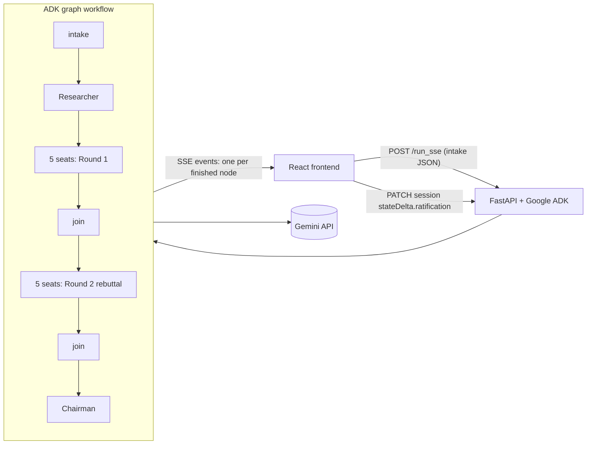

# Crucible

An AI board of advisors for small-business owners. The owner brings a decision; five AI seats research and debate it over two rounds; a Chairman recommends; **the owner makes the final call**.

| Seat | Job |
|---|---|
| Industry Expert | What an experienced operator in this industry would do |
| AI-Tools Expert | Real AI products that would help carry out the decision, with cost and fit |
| Realist | Legal, compliance, money, and goals checks: pass / flag / block |
| Strategist | Second- and third-order effects; the next move after this one |
| Devil's Advocate | The strongest honest case against the leading option |
| Chairman | Weighs the debate and recommends: proceed / pilot / defer / reject |

## Architecture



- `backend/agents/crucible/agent.py` — the workflow graph (ADK 2.x `Workflow` + `JoinNode`; seats in a round run in parallel).
- `backend/agents/crucible/schemas.py` — every model output is schema-constrained (Pydantic); the frontend mirrors these in `frontend/src/types.ts`.
- `backend/agents/crucible/seats.py` — seat charges and the briefings each seat sees. Seats cite shared evidence as F1, F2…
- `backend/main.py` — ADK's FastAPI app; all routes come from ADK (sessions, `/run_sse`, session PATCH).
- One run = 12 model calls (Researcher + 5 + 5 + Chairman).
- `frontend/src/home/` — the home page (`/`): the product, the five seats, an example verdict, recorded sessions, and the question form (`#convene`).
- `frontend/src/underthehood/` — `/under-the-hood`, the technical explainer. `buildFx.ts` is the "built by many hands" effect: one cursor per advisor assembles the page. It is skipped under reduced motion.
- Themes: every colour is a token in `frontend/src/styles/tokens.css`, defined once for dark and once for light. `index.html` picks the theme before first paint (saved choice, else the OS setting), and `ThemeToggle` switches it on every page.
- `frontend/src/components/Board.tsx` and `Crucible.tsx`: the meeting room. Seat cards arrive as each SSE event lands. In the crucible, each opening position adds to the melt and rebuttals refine it (glowing lines connect seats; concessions throw sparks). The Chairman's verdict pours out as a cast bar stamped with the decision, and the owner's call is stamped next to it.

## Run locally (Windows)

Requires Python 3.14 and Node 24. Put `OPENROUTER_API_KEY=...` in the repo-root `.env` (see `.env.example` for all settings).

```bash
# backend → http://127.0.0.1:8000
cd backend
python -m venv .venv
.venv/Scripts/python.exe -m pip install -r requirements.txt
.venv/Scripts/python.exe main.py

# frontend → http://localhost:5173
cd frontend
npm.cmd install
npm.cmd run dev
```

ADK's developer UI (inspect single runs, events, state): `cd backend && .venv/Scripts/adk web --port 8001 agents`. On first launch it asks about telemetry; answer `n`.

### Settings (`.env`)

| Variable | Default | Notes |
|---|---|---|
| `OPENROUTER_API_KEY` | — | needed for `openrouter/...` models (the defaults); prepaid credit is a hard spend cap |
| `GEMINI_API_KEY` | — | optional; only for bare Gemini model names such as `gemini-3.5-flash-lite` |
| `CRUCIBLE_SEAT_MODEL` | `openrouter/anthropic/claude-haiku-5.5` | the five seats |
| `CRUCIBLE_<SEAT>_MODEL` | — | per-seat override, e.g. `CRUCIBLE_REALIST_MODEL`, `CRUCIBLE_DEVILS_ADVOCATE_MODEL` |
| `CRUCIBLE_RESEARCHER_MODEL` | `openrouter/anthropic/claude-sonnet-5.5` | gets `:online` (web search) appended when search is on |
| `CRUCIBLE_CHAIR_MODEL` | `openrouter/anthropic/claude-sonnet-5.5` | |
| `CRUCIBLE_WEB_SEARCH` | `true` | OpenRouter web search (~$0.007/run) or, for Gemini names, Google Search (billed key only) |
| `CRUCIBLE_ALLOW_ORIGINS` | `http://localhost:5173` | comma-separated frontend origins |
| `CRUCIBLE_SESSION_DB` | ADK local store | `sqlite:///sessions.db`, `postgresql://…` |

**Cost:** with the defaults, measured runs cost $0.06–0.12 and take 50–85 s, mostly the Researcher's web search and the Chairman. `openrouter/...` names go through LiteLLM; bare Gemini names go to Google directly. The free Gemini tier allows about 20 requests a day per model and has no web search, so it suits local experiments only.

## Evaluate

```bash
cd backend
.venv/Scripts/python.exe eval/run_eval.py                                  # all 10 scenarios (130 calls)
.venv/Scripts/python.exe eval/run_eval.py --only bakery-price-increase     # one scenario
```

Each scenario in `eval/scenarios.json` has planted risks (`must_catch`), e.g. Maryland's all-party call-recording consent or the FLSA rule against managers taking from a tip pool. The report compares a single plain prompt (same model as the Chairman) with the full board, and with the Chairman's final verdict alone. Output: `eval/results/<timestamp>/report.md` plus a full transcript per scenario.

## Record a replay

Replays are real runs saved as SSE. The frontend plays them back with the original timing, so demos work without quota.

```bash
cd backend
.venv/Scripts/python.exe eval/record_replay.py dental-ai-receptionist     # API must be running
```

Output: `frontend/public/replays/<scenario>.sse`, or `<scenario>-error.sse` if the run failed. To show a new replay under "Watch a recorded session", add it to `REPLAYS` in `frontend/src/lib/replay.ts`. Any replay can be opened directly with `http://localhost:5173/?replay=<name>`. `dental-ai-receptionist-error` is a real failed run, where the Chairman hit a quota limit; use it to test the error screen.

## Deploy

**Backend → Cloud Run** (builds `backend/Dockerfile` remotely; one instance keeps ADK's sessions consistent):

```bash
gcloud secrets create openrouter-key --data-file=-   # paste the key, then Ctrl-D
gcloud run deploy crucible-api --source backend --region us-east1 --allow-unauthenticated \
  --min-instances 1 --max-instances 1 \
  --set-secrets OPENROUTER_API_KEY=openrouter-key:latest \
  --set-env-vars CRUCIBLE_ALLOW_ORIGINS=https://<your-app>.vercel.app
```

**Frontend → Vercel:** root directory `frontend`, env `VITE_API_BASE=<Cloud Run URL>`.

Sessions live in the container's local store and reset on redeploy. Set `CRUCIBLE_SESSION_DB` to a Postgres URL for durable decision history.
